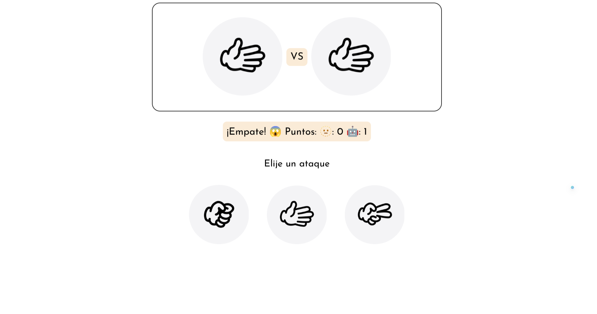

<div align="center">

# 🪨📋✂️ PPT — Piedra, Papel o Tijeras

Piedra, Papel o Tijeras clásico contra la computadora, hecho en JavaScript puro — sin frameworks, sin dependencias.


</div>

<br>

<div align="center">
  
</div>

<br>

## 📑 Contenido

- [Sobre el proyecto](#-sobre-el-proyecto)
- [Cómo jugar](#-cómo-jugar)
- [Instalación](#-instalación)
- [Cómo está construido](#-cómo-está-construido)
- [Autor](#-autor)

---

## 📖 Sobre el proyecto

Uno de mis primeros proyectos aprendiendo a programar: el clásico Piedra, Papel o Tijeras, pero contra la computadora. Lo uso para practicar manipulación del DOM y manejo de eventos en JavaScript sin ninguna librería de por medio — cada clic, cada punto y cada imagen que cambia en pantalla está resuelto a mano.

## 🎮 Cómo jugar

Elegís piedra, papel o tijeras haciendo clic en una de las tres imágenes. La computadora responde con una elección al azar, se compara contra las reglas clásicas del juego y se suma el punto a quien corresponda. Gana quien llegue primero a **5 puntos**.

## 🔧 Instalación

No requiere instalación ni dependencias — es HTML, CSS y JS puros.

```bash
git clone https://github.com/Juanma-Alvarado/PPT.git
cd PPT
```

Abrí `index.html` directamente en el navegador, o serví la carpeta con cualquier servidor estático:

```bash
npx serve .
```

## 🏗️ Cómo está construido

- **HTML5** — estructura de la pantalla de juego y los botones de ataque.
- **CSS3** — estilos con flexbox, fuente [Josefin Sans](https://fonts.google.com/specimen/Josefin+Sans) de Google Fonts.
- **JavaScript (vanilla)** — lógica del juego: `addEventListener` en cada botón, comparación de elecciones, marcador y renderizado dinámico de imágenes en el DOM.

## 👤 Autor

**Juan Manuel Alvarado** — Data Analyst Jr. & Data Scientist Jr.
[GitHub](https://github.com/Juanma-Alvarado) · [Portfolio](https://juanma-alvarado.github.io/PortafolioWeb)
